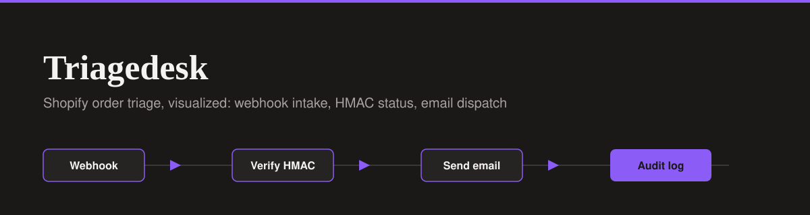

<div align="center">




</div>

# Triagedesk - E-Commerce Order Triage Dashboard

A premium B2B dashboard that acts as the UI layer for an n8n automation pipeline. This app visualizes the logic of **Workflow 2 (Shopify Order Confirmation Pipeline)** by simulating incoming webhook payloads, HMAC verification, and automated email dispatch.

**Live Demo:** [triagedesk.lovable.app](https://triagedesk.lovable.app)

## n8n Workflow Reference

This UI is designed to accompany a self-hosted n8n automation. You can view the actual backend workflow code and documentation in my platform integration portfolio:

- **Repository:** [platform-integration-portfolio](https://github.com/Xhenzouu/platform-integration-portfolio)
- **Workflow Documentation:** [Workflow 2: Shopify Order Confirmation Pipeline](https://github.com/Xhenzouu/platform-integration-portfolio/blob/main/docs/workflows/02-shopify-order-confirmation-pipeline.md)
- **Raw Workflow JSON:** [shopify-order-confirmation-pipeline.json](https://github.com/Xhenzouu/platform-integration-portfolio/blob/main/workflows/shopify-order-confirmation-pipeline.json)

The n8n workflow handles the following logic:

1. Receives an `orders/create` webhook from Shopify.
2. Verifies the Shopify HMAC signature using a Code node (HMAC-SHA256).
3. Builds a table-based HTML confirmation email.
4. Sends the email via the Resend API.
5. Writes a fulfillment note back to the Shopify order.
6. Logs the success or failure to a Supabase audit table (with idempotency on the `webhook_id`).

This dashboard visualizes that exact flow: the table shows the webhook intake and HMAC status, while the right-side drawer displays the generated HTML email and the database audit metadata.

## Features

- **Order Triage Table:** Displays incoming webhook payloads with a clear view of HMAC validity and email dispatch status.
- **Order Drawer:** A slide-out panel that details the order items and the webhook audit metadata (Webhook ID, Shopify Note Status, Resend ID).
- **Mock Email Preview:** Simulates the exact HTML email built by the n8n Resend node, complete with a white background to mimic an actual inbox.
- **Top Navigation:** A clean, distraction-free layout that differs from standard sidebar dashboards.
- **Core UI Pattern:** Strict flat charcoal (#1A1918), solid accents, and no gradients.

## Run Locally

1. Clone the repo:

   ```bash
   git clone https://github.com/Xhenzouu/triagedesk.git
   cd triagedesk
   ```

2. Install dependencies:

   ```bash
   npm install
   ```

3. Start the development server:

   ```bash
   npm run dev
   ```
